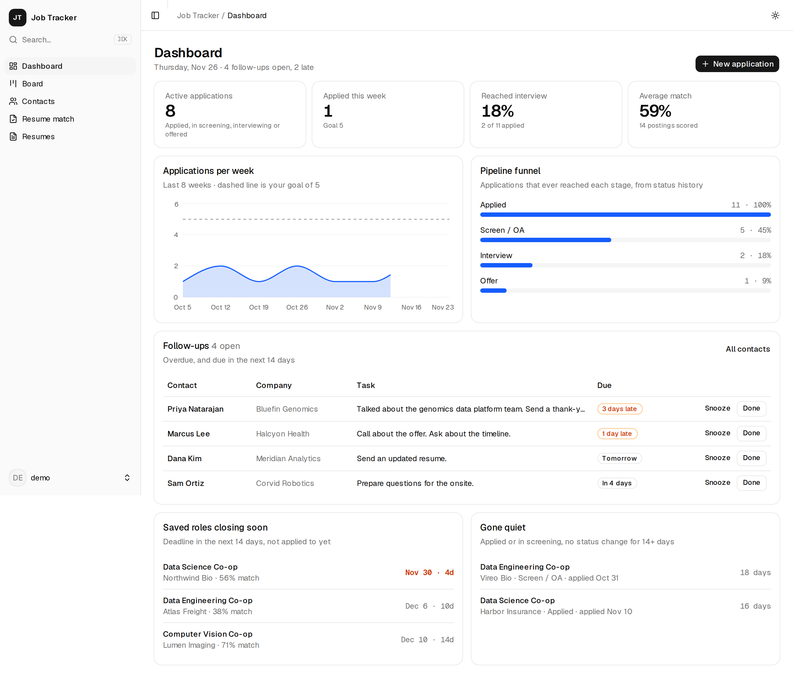
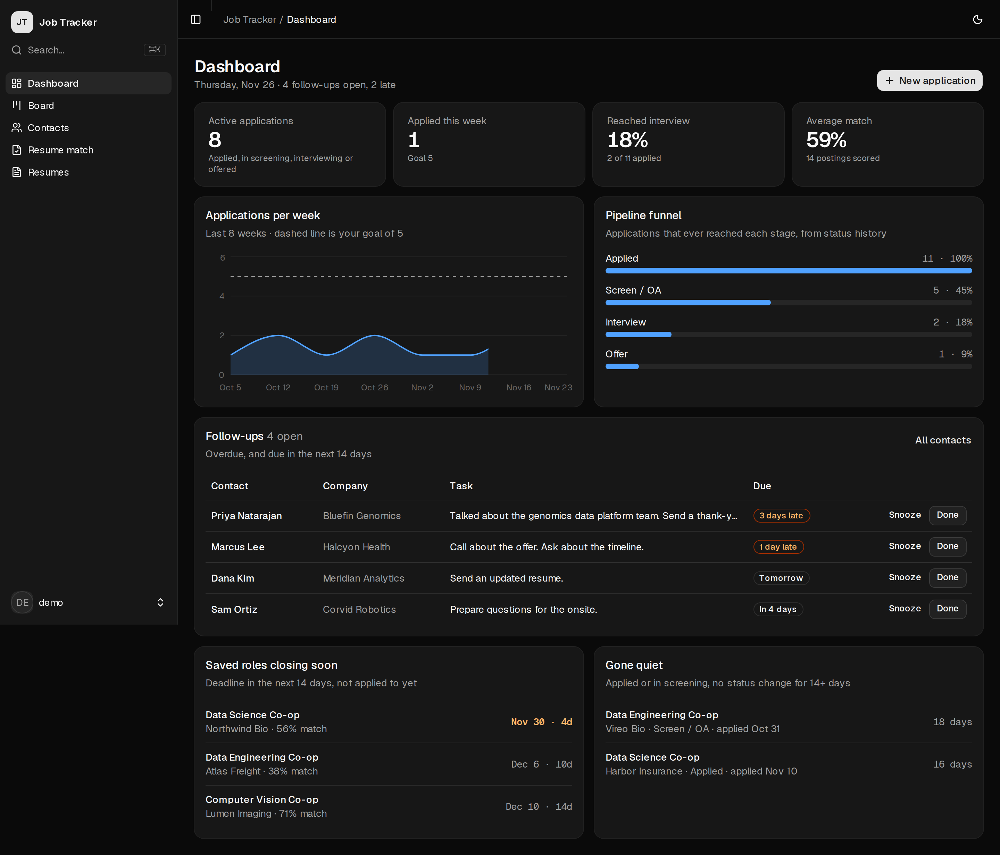
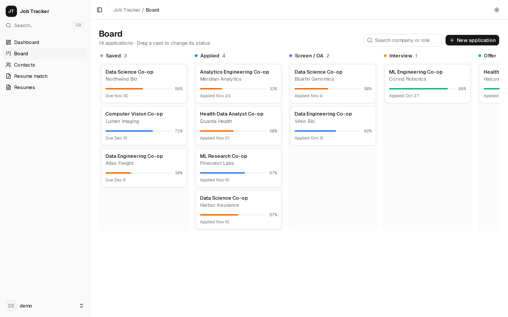
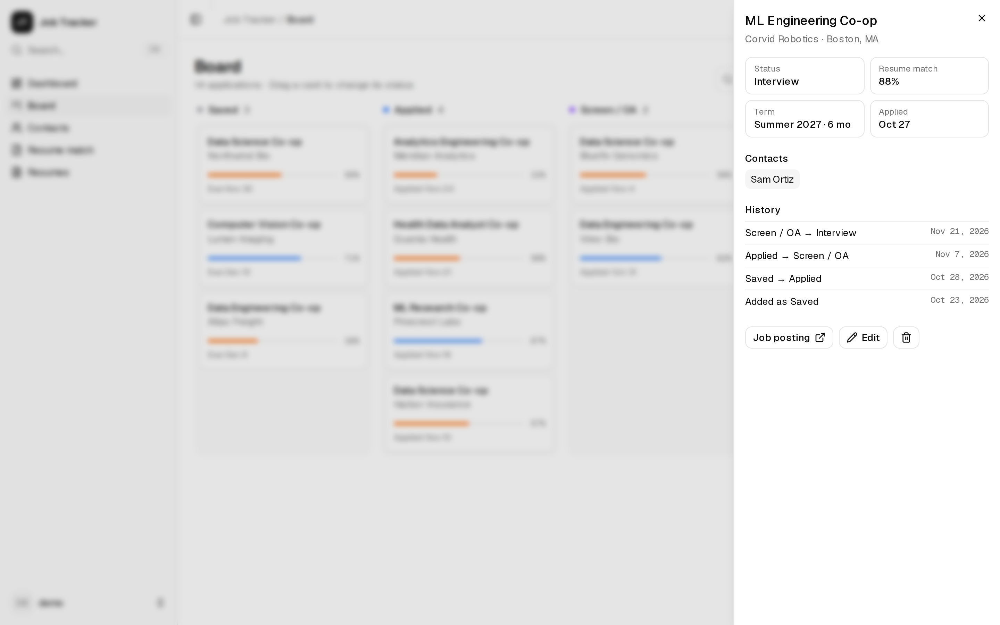
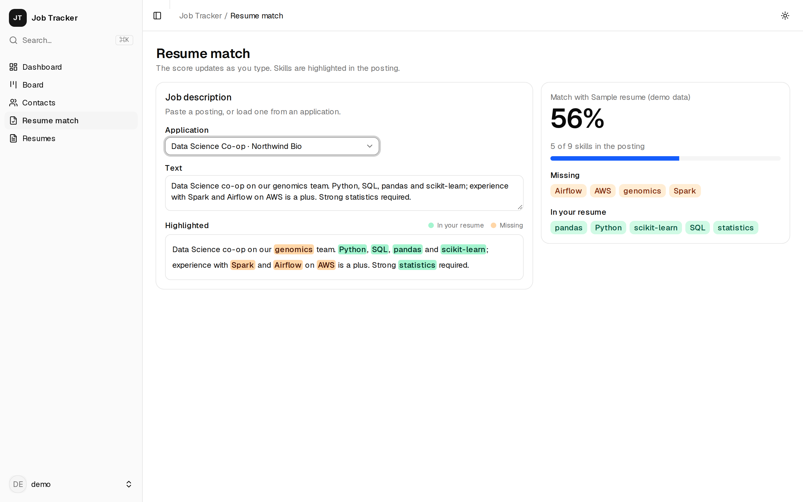
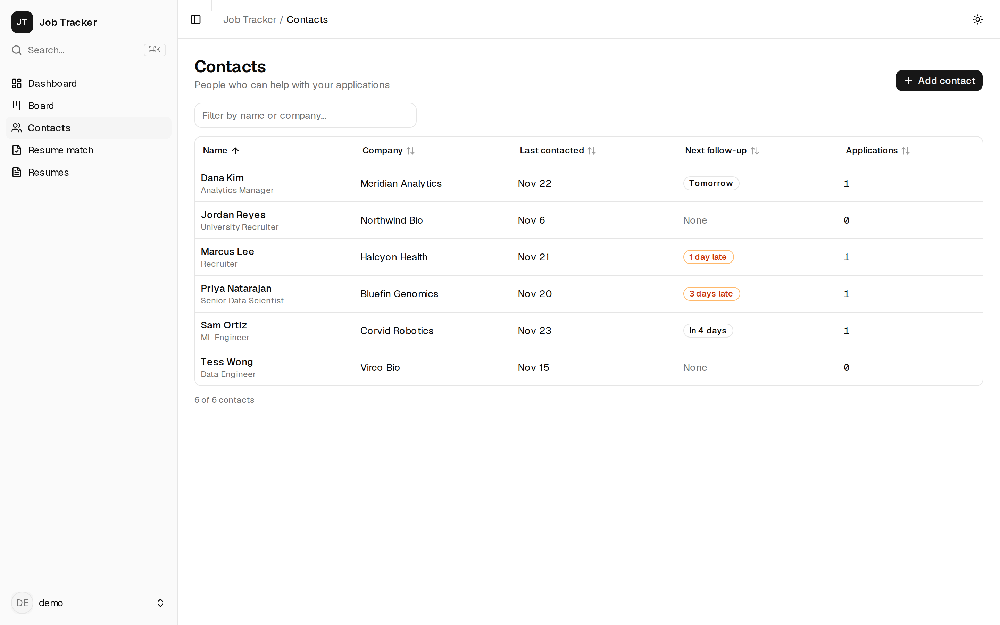
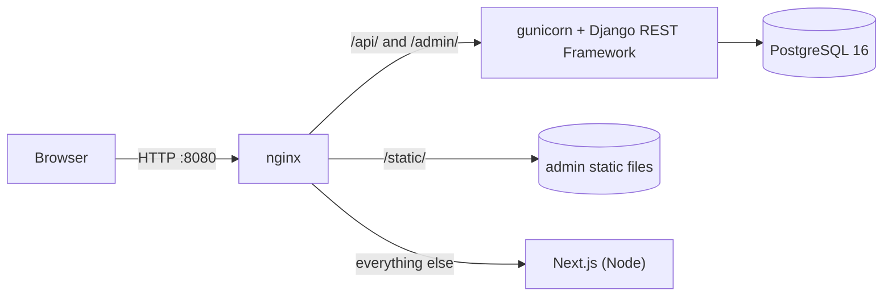
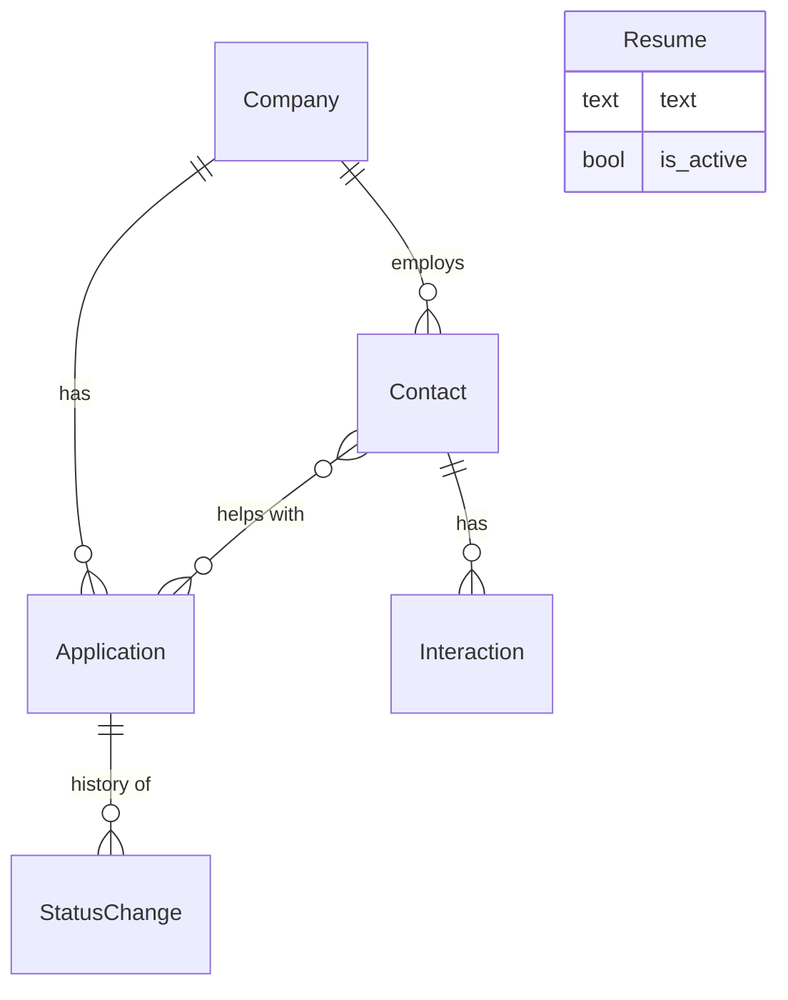

# Job Tracker

A web app for running a co-op or job search: a drag-and-drop application board, a dashboard that says what to do next, contact and follow-up tracking, and a resume matcher that scores each posting live and highlights the skills it asks for that your resume does not mention.

**Stack:** Next.js 16 + TypeScript + shadcn/ui frontend, Django REST Framework API, PostgreSQL 16, nginx, Docker Compose. The screenshots use made-up companies and a sample resume (`manage.py seed_demo`).

| Dashboard (light) | Dashboard (dark) |
|---|---|
|  |  |

## Problem

Co-op applications open in a short window and quickly turn into dozens of roles. Keeping track of statuses, deadlines, the people you have talked to, and how well your resume fits each posting is easy to get wrong in a spreadsheet. This app keeps it in one place and answers questions a spreadsheet cannot: what share of my applications reach an interview, which ones have gone quiet, and which skills do postings keep asking for that my resume lacks?

## Features

- **Board:** seven status columns. Drag cards with the mouse or the keyboard (Space to pick up, arrow keys to move, Space to drop). Moves show instantly, roll back with an explanation if the server rejects them, and offer **Undo**. Click a card for its status history.
- **Dashboard:** stat tiles, applications per week against a weekly goal, a pipeline funnel built from status history, follow-ups with **Done** and **Snooze**, saved roles closing soon, and applications that have **gone quiet** (no status change for 14+ days).
- **Contacts:** a sortable, filterable table; each contact has a timeline of interactions with follow-up dates.
- **Resume match:** paste a posting and the score updates as you type. Skills are highlighted in the text (green if your resume has them, orange if not), and every resume version is compared side by side.
- **Dark and light themes**, following the operating system by default. **⌘K** opens a command menu.
- **Private by design:** single user, and every API endpoint requires a logged-in session.

| Board | Detail panel |
|---|---|
|  |  |

| Resume match | Contacts |
|---|---|
|  |  |

## Architecture



Four containers: `db`, `web` (Django API), `frontend` (Next.js) and `nginx`.

| Decision | Why |
|---|---|
| **One origin for frontend and API** (nginx routes by path) | Cookies just work and no CORS setup is needed. |
| **Django session cookie + CSRF**, not JWTs | Tokens in browser storage can be stolen by injected scripts and need refresh logic. With one origin, Django's built-in sessions are simpler and safer. The login endpoint enforces CSRF explicitly, because DRF only does that for users who are already logged in. |
| **Typed API contract** | `drf-spectacular` generates `frontend/openapi.yml` from the API, and `openapi-typescript` turns it into TypeScript types. CI fails if either is out of date, so an API change that breaks the frontend fails to compile. |
| **Business rules in plain Python** (`services.py`, `dashboard.py`, `matching.py`) | The API, the admin and management commands all share one copy of the rules. |
| **Pages rendered in the browser, data from TanStack Query** | Everything is behind login, so server rendering would add complexity (forwarding cookies) for no benefit. TanStack Query provides caching and the optimistic updates behind instant drag-and-drop and Undo. |
| **shadcn/ui** (Radix + Tailwind) | Accessible components copied into the repo (`frontend/src/components/ui/`), so they can be edited directly. |

## Data model



- `Application.save()` writes a `StatusChange` row whenever the status is new or different, inside a transaction. It lives in the model, so a change is logged whether it comes from the board, the admin or a script.
- The funnel and "gone quiet" are computed from that history. An application that reached Interview and was then rejected still counts as having reached Interview, which a snapshot of current statuses cannot show.
- The database itself guarantees at most one active resume (a partial unique constraint).
- `Application.company` uses `PROTECT`, so deleting a company cannot silently delete its applications.

## How the resume match works

1. Find which skills from a curated vocabulary (`tracker/skills.py`, about 200 terms plus aliases such as `sklearn` for scikit-learn) appear in the job description.
2. Find which of those also appear in the resume.
3. Score = matched skills / skills in the posting.

Word-boundary rules stop `SQL` matching inside `MySQL`, `git` inside `GitHub`, or `js` inside `Node.js`. Ambiguous words such as `R`, `Spark` and `Excel` count only when capitalized. The API also returns **where** each skill appears (`matching.find_spans`), so the frontend highlights text using exactly the same rules as the score instead of a second copy in TypeScript. One test runs every skill and alias through both code paths to prove they agree.

**Limitations:** a skill that is not in the vocabulary is invisible, and matching is by term, not meaning ("ETL pipelines" does not count as "data pipeline"). The score is a prompt to look at the missing keywords, not a measure of fit. A natural next step is embedding-based matching.

## Run it locally

You need Docker Desktop. Node and Python are not needed on your machine.

```bash
cp .env.example .env          # then replace the two change-me values
docker compose up --build -d
docker compose exec web python manage.py createsuperuser
```

One way to make a secret key: `python3 -c "import secrets; print(secrets.token_urlsafe(50))"`.

Open http://localhost:8080 and log in. To try it with made-up data (14 applications, 6 contacts and a sample resume, with dates relative to today):

```bash
docker compose exec web python manage.py seed_demo          # load
docker compose exec web python manage.py seed_demo --clear  # remove the demo data and nothing else
```

For frontend development with live reload:

```bash
docker compose -f docker-compose.yml -f docker-compose.dev.yml up
```

The API is documented at http://localhost:8080/api/docs/ (after logging in).

## Tests and CI

```bash
docker compose run --rm web python manage.py test                                                   # backend
docker run --rm -u node -e HOME=/tmp -v "$PWD/frontend":/work -w /work node:24-alpine npm test      # frontend
```

- **Backend, 124 tests:** status history, the funnel, the login flow and CSRF enforcement, a check that every API route requires login, drag-and-drop validation, scoring and rescoring, dashboard date logic pinned to a fixed date, skill spans, and the demo-data command.
- **Frontend, 88 tests** (Vitest + Testing Library): optimistic moves and follow-up actions with rollback and Undo, safe post-login redirects, CSRF handling, sorting with empty values last, skill highlighting, form error display, and every page. Tests run in Boston's time zone so date logic meets daylight saving time.
- **Checked in a real browser** (Playwright): mouse and keyboard drag-and-drop, Undo, and opening cards. This found three bugs that simulated-browser tests could not.

GitHub Actions (`.github/workflows/ci.yml`) runs on every push to `main` and every pull request, in three jobs:
- **Backend:** lint, Django checks, missing migrations, API schema up to date, and the tests on PostgreSQL 16.
- **Frontend:** generated types up to date, lint, type check, tests, and a production build.
- **Docker:** builds all the containers.

## Project layout

```
config/                 Django settings and URLs (/api/ and /admin/)
tracker/
  models.py             Company, Application, StatusChange, Contact, Interaction, Resume
  services.py           scoring, resume activation, drag-and-drop moves, funnel
  dashboard.py          dashboard numbers and lists (date injectable for tests)
  matching.py, skills.py  resume matcher and its vocabulary
  api/                  serializers, views, auth and URLs for the REST API
  management/commands/  seed_demo
frontend/
  src/app/              pages: (app)/ for logged-in pages, login/
  src/components/       board, dashboard, contacts and application components; ui/ is shadcn/ui
  src/lib/              typed API client, data hooks, and plain-function logic with tests
  openapi.yml           API schema generated from Django
nginx/default.conf      routes /api and /admin to Django, everything else to Next.js
docs/FRONTEND-PLAN.md   design notes for the frontend rewrite
```

## Limitations and next steps

- Built for local, single-user use. Before putting it on the internet it needs HTTPS, secure cookie settings, `DEBUG` off, and configurable allowed origins (they are fixed to `localhost:8080`).
- Resume text is pasted in, with no PDF upload.
- The board is designed for desktop widths. Drag-and-drop on touch screens has not been tested.
- Ideas: email reminders for follow-ups, a browser extension to save postings, embedding-based matching, and adding the Playwright checks to CI.
