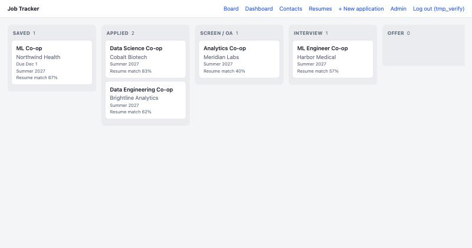
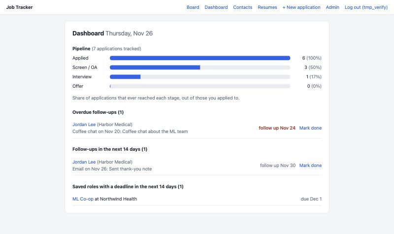
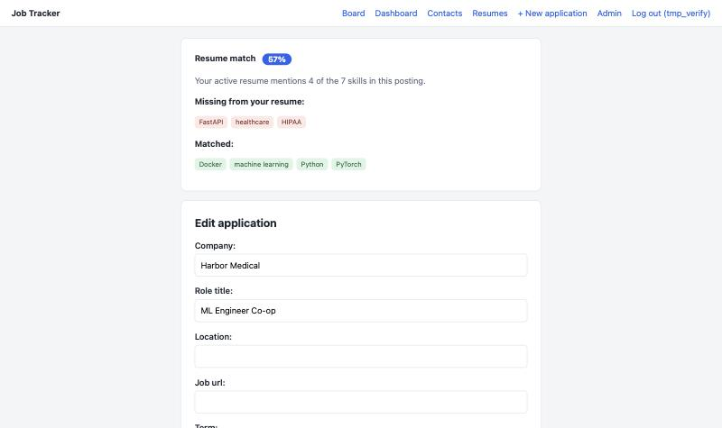
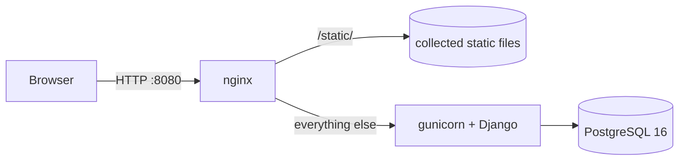
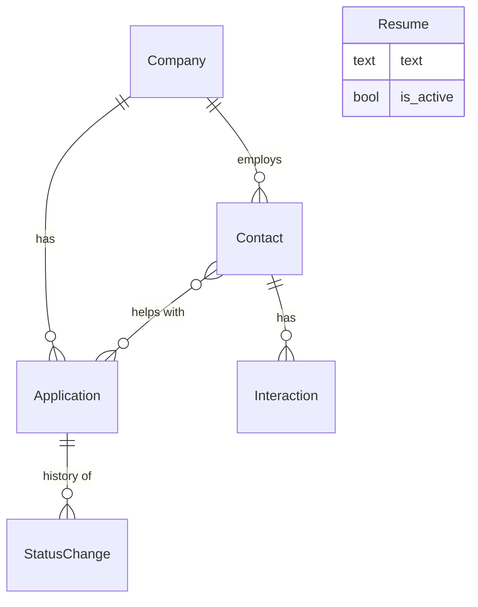

# Job Tracker

A personal web app for running a co-op or job search: a drag-and-drop application board, a contact and follow-up tracker, and a resume keyword matcher that shows which skills a posting wants that your resume does not mention.

Built with Django, PostgreSQL, nginx and Docker Compose. The screenshots use made-up companies and a sample resume.



## Problem

Co-op applications open in a short window and quickly turn into dozens of roles. Keeping track of statuses, deadlines, the people you have talked to, and how well your resume fits each posting is easy to get wrong in a spreadsheet. This app puts it in one place and answers questions a spreadsheet cannot, such as "what share of my applications reach an interview?"

## Features

- **Kanban board:** drag a card between Saved, Applied, Screen / OA, Interview, Offer, Rejected and Withdrawn. Order within a column is saved too.
- **Status history:** every status change is recorded, so the dashboard funnel reflects how applications actually progressed.
- **Contacts and interactions:** log coffee chats, emails and referrals, link a contact to applications, and set follow-up dates.
- **Dashboard:** pipeline funnel, overdue and upcoming follow-ups, and deadlines coming up for roles you have saved but not applied to.
- **Resume match:** paste a job description and get a score plus the matched and missing skills compared with your active resume.
- **Private by design:** single user with login. Every page requires it.

| Dashboard | Resume match |
|---|---|
|  |  |

## Architecture



| Piece | Why it is there |
|---|---|
| **Django** | Authentication, ORM, migrations, forms and admin out of the box, so the effort goes into the data model and logic. |
| **PostgreSQL** | Relational data with real constraints (for example, the database itself guarantees at most one active resume). |
| **gunicorn** | Django's development server is not meant for serving traffic. |
| **nginx** | Reverse proxy that serves static files directly and shields gunicorn. |
| **Docker Compose** | One command starts all three services identically on any machine. The database waits on a health check before the app starts. |
| **HTMX + SortableJS** | Drag-and-drop without a separate frontend app. Dropping a card sends one small POST. |

## Data model



- `Application.save()` writes a `StatusChange` row whenever the status is new or different, inside a transaction. It lives in the model so a change is logged whether it comes from the board, the admin or a script.
- The dashboard funnel counts how many applications ever reached each stage from that history. An application that reached Interview and was then rejected still counts as having reached Interview, which a snapshot of current statuses cannot show.
- `Application.company` uses `PROTECT`, so deleting a company cannot silently delete its applications.

## How the resume match works

1. Find which skills from a curated vocabulary (`tracker/skills.py`, about 200 terms plus aliases such as `sklearn` for scikit-learn) appear in the job description.
2. Find which of those also appear in the resume.
3. Score = matched skills / skills in the posting. Skills that only appear in the resume do not change the score.

The matcher (`tracker/matching.py`) is plain Python with no database access, so it is easy to test. Word-boundary rules stop `sql` matching inside `MySQL`, `git` inside `GitHub`, or `js` inside `Node.js`. Ambiguous words such as `R`, `Spark` and `Excel` count only when capitalized.

**Limitations:** a skill that is not in the vocabulary is invisible, and matching is by term rather than meaning, so "ETL pipelines" does not count as "data pipeline". The score is a prompt to look at the missing keywords, not a measure of fit. A natural next step would be TF-IDF or embedding-based matching.

## Run it locally

You need Docker Desktop.

```bash
cp .env.example .env
```

Edit `.env` and replace the two `change-me` values. One way to make a secret key:

```bash
python3 -c "import secrets; print(secrets.token_urlsafe(50))"
```

Then start everything and create your login:

```bash
docker compose up --build -d
docker compose exec web python manage.py createsuperuser
```

Open http://localhost:8080 and log in. Go to **Resumes** first and paste your resume as plain text.

## Tests and CI

```bash
docker compose run --rm web python manage.py test
```

There are 80 tests covering the status-history logic, the kanban move endpoint (including CSRF and input validation), login protection, the follow-up dashboard, the funnel, and the matcher's edge cases.

GitHub Actions (`.github/workflows/ci.yml`) runs on every push and pull request: `ruff` lint, Django system check, a check that no model change is missing its migration, the test suite against a real PostgreSQL 16 service, and a build of the Compose stack.

## Project layout

```
config/            Django settings and root URLs
tracker/
  models.py        Company, Application, StatusChange, Contact, Interaction, Resume
  views.py         board, move endpoint, contacts, resumes, dashboard
  forms.py         forms (find-or-create company by name, score on save)
  matching.py      pure resume/job-description matcher
  skills.py        skills vocabulary, aliases and case-sensitive terms
  services.py      scoring, resume activation, funnel query
  templates/       Django templates
  tests.py, test_matching.py
nginx/default.conf reverse proxy and static files
docker-compose.yml db, web and nginx services
docs/PLAN.md       original design notes
```

## Limitations and next steps

- Built for local, single-user use. Before putting it on the internet it needs HTTPS, `DEBUG` off, and configurable allowed origins (they are fixed to `localhost:8080`).
- The board loads HTMX and SortableJS from a CDN at pinned versions, so it needs internet access. Vendoring them would remove that dependency.
- Resume text is pasted in, with no PDF upload.
- No mobile layout for the board (it scrolls sideways).
- Ideas: email reminders for follow-ups, a browser bookmarklet to save a posting, and embedding-based matching.
