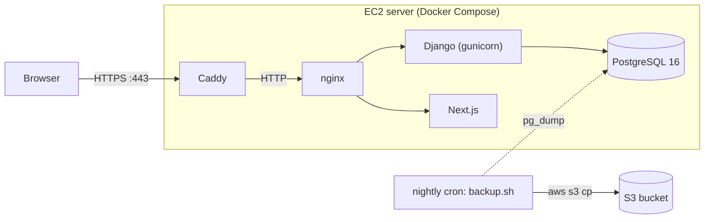

# Deploying to AWS (EC2)

One small Linux server runs the same Docker Compose stack as your laptop, plus Caddy for HTTPS.
Postgres runs in a container on that server, and backups are copied to S3 every night.



| Decision | Why |
|---|---|
| **EC2 + Compose**, not ECS/Kubernetes | One user, one server. The production stack is the same one tested locally, so there are fewer moving parts. |
| **Postgres in a container**, not RDS | RDS costs several times more than the server. Instead, nightly `pg_dump` backups go to S3, off the machine. |
| **Caddy in front of nginx** | Caddy gets and renews the Let's Encrypt certificate by itself. nginx keeps its existing job (routing by path), so local and production behave the same. |
| **An IAM role on the server**, not access keys | The server gets temporary credentials that can only write to the backup bucket. No AWS secret is stored on disk. |
| **Shared cap on logins** (20 per hour) | Anyone on the internet can reach the login page. This is a single-user app, so one global limit stops password guessing no matter how many IPs an attacker uses. |

Costs (us-east-1, roughly): `t3.small` about $15/month, or `t3.micro` about $7.50/month (free-tier eligible on some accounts); public IPv4 about $3.60/month; 20 GB disk about $1.60/month; S3 backups a few cents.

## 0. One-time account setup (AWS console)

1. Create the AWS account. Turn on **MFA** for the root user (Account menu → Security credentials).
2. **Billing → Budgets → Create budget → "Monthly cost budget"**, $10, alert to your email.
   New accounts on AWS's free plan start with credits and no card; the plan ends when the credits run out or after
   about six months unless upgraded, so keep a backup on your laptop as well.
3. Pick one region (e.g. `us-east-2`, Ohio) and use it for the server. S3 and IAM work across regions.
4. Get a domain (Route 53, or free via the GitHub Student Developer Pack). The examples use `jobs.example.com`.

## 1. S3 bucket for backups

1. **S3 → Create bucket**, named e.g. `jobtracker-backups-<something-unique>`. Keep **Block all public access** on.
2. Bucket → **Management → Create lifecycle rule** → apply to all objects → "Expire current versions" after 30 days.

## 2. IAM role for the server

**IAM → Roles → Create role** → trusted entity **AWS service → EC2** → skip the managed policies → name it
`jobtracker-ec2`. Then open the role → **Add permissions → Create inline policy → JSON**, using your bucket name:

```json
{
  "Version": "2012-10-17",
  "Statement": [{ "Effect": "Allow", "Action": "s3:PutObject", "Resource": "arn:aws:s3:::YOUR-BUCKET/*" }]
}
```

The server can add backups but cannot read or delete them. If the server were compromised, the old backups stay safe.

## 3. Launch the server

**EC2 → Launch instance**:

- Name `job-tracker`, image **Ubuntu Server LTS** (24.04 or newer, 64-bit x86), instance type **t3.small** (or t3.micro; see the swap step below)
- Key pair: create one, `job-tracker`, type ED25519, `.pem`. It downloads once; keep it safe.
- Network settings → **Create security group** with three rules:
  SSH (22) from **My IP**, HTTP (80) from Anywhere, HTTPS (443) from Anywhere.
  Check the SSH address: with Safari's iCloud Private Relay or a VPN, "My IP" fills in the relay's address, not
  yours, and SSH times out. Compare it with `curl https://checkip.amazonaws.com` run in Terminal.
- Storage: 20 GB gp3
- Advanced details → **IAM instance profile**: `jobtracker-ec2`

Then **EC2 → Elastic IPs → Allocate → Associate** it with the instance. This gives a fixed address that survives
restarts.

**DNS:** add an **A record** for `jobs.example.com` pointing at the Elastic IP.

## 4. Set up the server

On your Mac:

```bash
mv ~/Downloads/job-tracker.pem ~/.ssh/
chmod 400 ~/.ssh/job-tracker.pem
ssh -i ~/.ssh/job-tracker.pem ubuntu@ELASTIC-IP
```

On the server, install Docker and the AWS CLI:

```bash
curl -fsSL https://get.docker.com | sudo sh
sudo usermod -aG docker ubuntu
sudo snap install aws-cli --classic
exit
```

(`exit` and ssh back in, so the docker group applies.)

**Only on a t3.micro** (1 GB of memory, too little for the Next.js build), add 2 GB of swap:

```bash
sudo fallocate -l 2G /swapfile && sudo chmod 600 /swapfile && sudo mkswap /swapfile && sudo swapon /swapfile
echo '/swapfile none swap sw 0 0' | sudo tee -a /etc/fstab
```

## 5. Deploy

```bash
git clone https://github.com/PaulinaSkurzak/job-tracker.git
cd job-tracker
cp .env.example .env
openssl rand -base64 48   # run twice: one for DJANGO_SECRET_KEY, one for POSTGRES_PASSWORD
nano .env
```

In `.env`, paste the two secrets, then uncomment the production block and fill in your domain and bucket:

```
DJANGO_DEBUG=0
COMPOSE_FILE=docker-compose.yml:docker-compose.prod.yml
DOMAIN=jobs.example.com
DJANGO_ALLOWED_HOSTS=jobs.example.com
DJANGO_CSRF_TRUSTED_ORIGINS=https://jobs.example.com
DJANGO_HTTPS=1
BACKUP_S3_BUCKET=jobtracker-backups-...
```

Delete the earlier `DJANGO_DEBUG=1` line. Save with Ctrl+O, Enter, then exit with Ctrl+X.

```bash
docker compose up -d --build
docker compose logs caddy --tail 20     # look for "certificate obtained successfully"
```

`COMPOSE_FILE` in `.env` makes every plain `docker compose` command use the production file too.

Open https://jobs.example.com. On the `/capture` page, drag the bookmarklet to your bookmarks bar again: the old one
points at localhost.

## 6. Move your data from the laptop

On your Mac, in the job-tracker folder:

```bash
./scripts/backup.sh
scp -i ~/.ssh/job-tracker.pem backups/jobtracker-<newest>.dump ubuntu@ELASTIC-IP:~/job-tracker/
```

On the server:

```bash
cd ~/job-tracker && mkdir -p backups && mv jobtracker-*.dump backups/
./scripts/restore.sh backups/jobtracker-<newest>.dump
```

This brings your account and password along. To start fresh instead, run
`docker compose exec web python manage.py createsuperuser`.

## 7. Nightly backups

On the server, run `crontab -e` and add:

```
0 3 * * * cd /home/ubuntu/job-tracker && ./scripts/backup.sh >> backups/backup.log 2>&1
```

Check the next morning with `tail backups/backup.log` and in the S3 console.

## Updating

```bash
ssh -i ~/.ssh/job-tracker.pem ubuntu@ELASTIC-IP
cd job-tracker && git pull && docker compose up -d --build
```

Once everything has worked for a week, raise HSTS with `DJANGO_HSTS_SECONDS=31536000` in `.env`.
