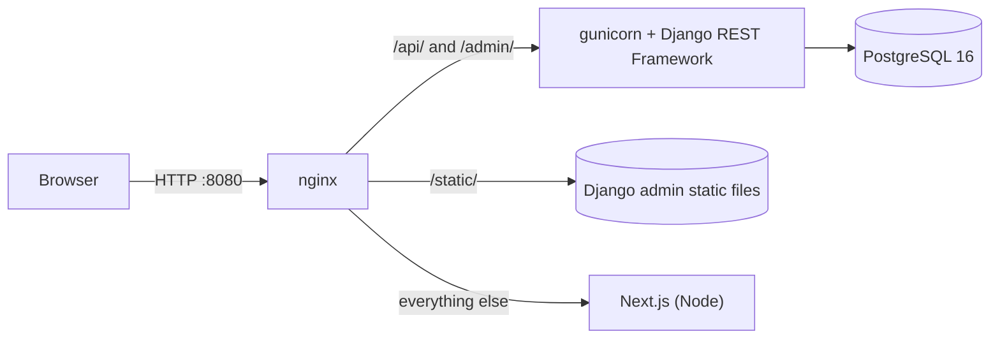

# Plan: Next.js + shadcn/ui frontend

Branch: `ui-redesign`. Goal: replace the Django-template UI with a React frontend that matches the
mockups (sidebar shell, combined dashboard, kanban with detail panel, contacts data table, live
resume match), with dark and light mode. Django stays as the backend and becomes a JSON API.

## Architecture

Four containers: `db`, `web` (Django API), `frontend` (Next.js), `nginx`.

### Key decisions

| Decision | Choice | Why (and what I rejected) |
|---|---|---|
| Where the frontend lives | `frontend/` folder in this repo | One repo, one CI, one README. A separate repo would split the story in two. |
| How the browser reaches both apps | nginx routes `/api/` to Django and everything else to Next.js, on the **same origin** (`localhost:8080`) | Same origin means no CORS setup and cookies just work. |
| Authentication | **Django session cookie + CSRF token** (what the app already uses) | JWTs stored in the browser are easier to steal via XSS and need refresh logic. Sessions are the standard choice when frontend and API share an origin. |
| API framework | Django REST Framework (DRF) | The standard for Django APIs: serializers do validation, viewsets give CRUD with little code. |
| API contract | `drf-spectacular` generates an OpenAPI schema; `openapi-typescript` turns it into TypeScript types | If the API changes, the frontend stops compiling instead of breaking at runtime. A good interview talking point. |
| Rendering | Next.js App Router, pages rendered in the browser, data fetched with **TanStack Query** | Everything is behind login, so server rendering gains little (no SEO) and would need cookie forwarding. TanStack Query gives caching, refetching and optimistic updates (instant drag and drop, undo). |
| Components | shadcn/ui (Radix + Tailwind), copied into `frontend/components/ui/` | Matches the mockups; you own the code. |
| Extras | `@dnd-kit` (drag and drop), Recharts via shadcn charts, `sonner` (toasts with Undo), `cmdk` (⌘K menu), `next-themes` (dark/light) | Each is the common choice for its job in the shadcn ecosystem. |
| Language | TypeScript, strict mode | Expected for React roles; catches API mismatches. |
| Package manager | npm | Ships with Node; one less tool to explain. |

## API design

All endpoints require login except `csrf` and `login`. JSON in and out.

| Method and path | Purpose |
|---|---|
| `GET /api/auth/csrf/` | Sets the CSRF cookie the frontend sends back on writes |
| `POST /api/auth/login/`, `POST /api/auth/logout/`, `GET /api/auth/me/` | Session login, logout, current user |
| `GET, POST /api/companies/` | List (for autocomplete), create |
| `GET, POST /api/applications/` and `GET, PATCH, DELETE /api/applications/{id}/` | CRUD. Filters: `?status=`, `?term=`, `?q=` (company or role). Detail includes status history and linked contacts. |
| `POST /api/applications/{id}/move/` | `{status, ids}` from drag and drop: the target column and its cards' ids in their new order (one request fixes the whole column's order, so positions cannot drift). Reuses `services.move()`, so a `StatusChange` is still written by `Application.save()`. |
| `GET, POST /api/contacts/` and `GET, PATCH, DELETE /api/contacts/{id}/` | CRUD. List includes last interaction and next follow-up (for the data table). |
| `POST /api/contacts/{id}/interactions/` | Log an interaction |
| `PATCH /api/interactions/{id}/` | Mark a follow-up done, or snooze it (move `follow_up_date`) |
| `GET, POST /api/resumes/`, `PATCH /api/resumes/{id}/`, `POST /api/resumes/{id}/activate/` | Resume management |
| `POST /api/match/` | `{job_description, resume_id?}` returns `{score, matched, missing}` without saving. Powers live scoring as you type (debounced). With no `resume_id`, returns a score per resume for the "compare versions" panel. |
| `GET /api/dashboard/` | Everything the combined dashboard shows, in one request |

### New backend features (from the mockups)

These are new logic, so each gets tests:

- **Weekly applications**: counts per week by `date_applied`, last 8 weeks, plus a weekly goal (a setting for now).
- **Gone quiet**: applied 14+ days ago with no `StatusChange` since. Uses the status history you already store.
- **Snooze**: moves a follow-up date forward 2 days. No schema change.
- **Stat tiles**: active applications, applied this week, share that reached interview, average match score.

No database schema changes are needed.

## Build order

Each step is one commit (or a few), with tests, and leaves the app working.

1. **API foundation**: add DRF and drf-spectacular, session auth endpoints, CSRF, the OpenAPI schema at `/api/schema/`, tests for login protection.
2. **API resources**: applications (with `move`), companies, contacts, interactions, resumes, match. Port the existing view tests (status history, move validation, login required) to API tests.
3. **Dashboard endpoint**: stats, funnel, weekly counts, follow-ups, deadlines, gone quiet, with tests.
4. **Frontend scaffold**: Next.js + TypeScript + Tailwind + shadcn/ui in `frontend/`, Docker service, nginx routing, generated API types, login page, app shell (sidebar, dark/light toggle, ⌘K menu).
5. **Board**: columns, drag and drop with optimistic update, detail panel, toast with Undo.
6. **Dashboard**: the combined design.
7. **Contacts**: data table (sort, filter, select), contact detail with interaction timeline.
8. **Resume match and forms**: live match page, resumes page, new and edit application form.
9. **Cleanup and CI**: remove the old template views and templates (keep Django admin), add a frontend CI job (lint, type check, Vitest tests, production build), bump GitHub Actions versions, update README with the new diagram and screenshots.

Old pages keep working until step 9, so the app is never broken mid-way. Since step 4 they live at
`/classic/` (Next.js owns `/`), and nginx sends `/api/`, `/admin/`, `/accounts/` and `/classic/` to Django.

Change from the original order: the frontend CI job (lint, type check, tests, build, and checks that the
committed API schema and generated types are current) was added in step 4 rather than step 9, so every
later step is checked.

## Testing

- Backend: Django test runner, as today. API tests replace template-view tests; matcher and model tests stay as they are.
- Frontend: Vitest + React Testing Library for components with logic (board move, live match, follow-up actions); API calls mocked with MSW.
- CI runs both, plus the production `next build` and the Compose build.

## Out of scope

Deployment to the internet, multi-user accounts, mobile drag and drop polish, PDF resume upload.

## Outcome

All nine steps are done (pull request #1). Changes from the plan along the way:

- The move endpoint takes `{status, ids}` (the whole target column's order) instead of `{status, position}`.
- The frontend CI job arrived in step 4 rather than step 9, so every later step was checked.
- `POST /api/match/` also returns where each skill appears (`spans`), so highlighting uses the matcher's own rules.
- The classic pages lived at `/classic/` from step 4 and were removed in step 9, with the 43 tests that only covered them.
  Three rules tested only there moved into service tests.
- A real-browser check (Playwright) before release found three bugs that jsdom tests could not: Enter opened and
  immediately closed the detail panel, keyboard dragging could not reach other columns, and the drag preview's
  rotation confused keyboard movement. It also found the board stretching the page sideways (a missing `min-w-0`).
